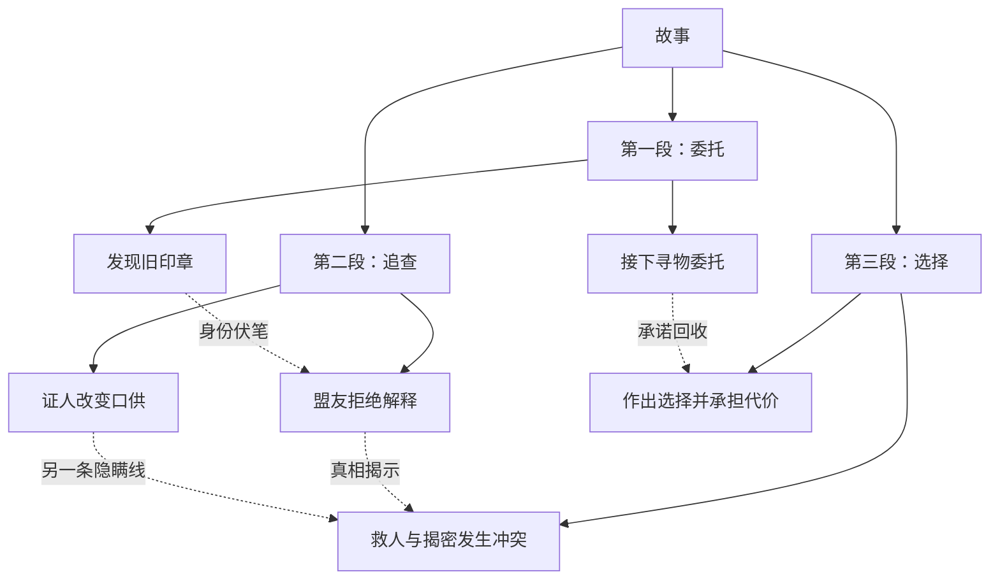

# 小说蒸馏与长期创作资料库改造设计

日期：2026-10-22。状态：待用户审阅；本文定义目标行为，不代表功能已实现。

## 1. 目标与已确认需求

把 `distill-novels` 从按次输出分析的 Skill 扩展为可持续积累的个人小说研究与创作工具：

1. 蒸馏人物卡与优秀剧情素材长期保存，可被多个小说项目检索、引用和再加工。
2. 每部来源小说和原创项目都有剧情结构：主线可按树浏览，暗线可跨章节、不连续地连接多个节点。
3. 创作中的实际使用与复盘回流资料库，积累可复用经验。
4. 用户已明确 Codex 和 ChatGPT 两边都会经常使用，必须能方便衔接。

本地《工作架构框架 V0.3》已有 library/books 分层及角色卡、Bible、秘密表、伏笔表设计。本次沿用这些职责和“参考资料、未来计划、定稿事实分开”的原则；不把旧文档的市场、语言和受众试验假设设为通用默认值。

## 2. 方案比较与推荐

### 2.1 保存与双端使用

| 方案 | 好处 | 代价和迁移成本 |
|---|---|---|
| A：文件主库＋私有 GitHub 备份＋ChatGPT/Space 工作副本（推荐） | 可恢复、可审查版本；本地和云端都能使用；保留现有 Skill | 需要一次配置保存位置；双端通过版本化同步，不能直接假定实时一致。未来更换数据库可从结构化文件迁移 |
| B：Space 页面作为主库，定期导出文件 | 日常云端编辑方便 | 本地使用依赖导出或连接器；结构校验和批量恢复仍需工具。迁移到 Git 时需补齐稳定 ID、关系和版本 |
| C：独立数据库与完整 Web 应用 | 可做集中搜索和多人协作 | 要维护服务、账号、备份与部署；与当前小型 Skill 差距大，建设和后续迁移成本最高 |

推荐 A。完整资料落在文件主库；GitHub 保存版本与异机副本；Space 保存便于阅读和编辑的工作副本；GPT 记忆仅保存偏好与入口提示。第一版先支持用户触发的同步，不新增后台同步服务。

### 2.2 剧情结构

| 方案 | 取舍 | 推荐与迁移 |
|---|---|---|
| A：单一剧情树 | 简单，但暗线多对多连接与跨章节回收难表达 | 只作为主线视图；以后改图需补录暗线关系 |
| B：剧情节点＋结构树＋关系边＋暗线集合 | 同一份资料可生成主线树和暗线网络 | 推荐；JSON 是数据依据，图只是视图。后续可替换渲染器而不用重做分析 |

“不规则暗线”本版解释为跳跃、交叉、分叉、汇合的关系网络；初版可切换和筛选显示，不包含大型拖拽编辑器。

### 2.3 卡片格式

| 方案 | 取舍 | 推荐与迁移 |
|---|---|---|
| A：Markdown 是唯一主档 | 手动编辑最直接；复杂关系、冲突合并和字段校验较难 | 需要严格格式和解析约定，后续迁移成本中等 |
| B：JSON 主档＋生成的 Markdown 阅读卡 | 便于校验、引用、版本比较；阅读卡友好 | 推荐；用户通过自然语言操作，工具维护 JSON。手工改阅读卡应作为修改提案回收 |

一项资料只有一个权威内容版本。生成的 Markdown 不成为第二个独立主档；人工笔记有受保护字段。

## 3. 文件布局与边界

目标布局如下，除现有代码目录外，其余为待实现结构：

```text
Novel/
  docs/工作架构框架-v0.3.md        既有框架，保持历史
  distill-novels/                  工具代码、Skill、规范、测试与原创示例
  writing-vault/                   个人资料库；将来关联独立私有 Git 仓库
    vault.json                    资料库 ID、schema 版本
    library/
      sources/                    来源登记、修订与证据索引
      characters/                 人物研究卡与可复用人物机制卡
      scenes/                     剧情片段研究卡、场景机制和原创片段
      patterns/                   人物弧、情绪回报、伏笔等综合经验
      views/                      自动生成的 Markdown 卡片与目录
    books/<project-id>/
      project.json                项目信息和采用的资产版本
      bible.md                    本作品设定
      characters/                 本作品原创人物实例
      outline/                    未来剧情计划及图数据
      canon/                      定稿事实、秘密与回收状态
      chapters/                   稿件和审稿记录
      usage/                      素材使用与反馈
    exchanges/                    双端工作包、回收提案与同步记录
    private-sources/               原始小说；默认不进 Git
    .cache/                       可重建索引与图视图；默认不进 Git
```

`writing-vault` 可放在其他位置，按显式路径配置。作品引用使用资料库 ID＋资产 ID＋修订号，不把本机绝对路径写进可交换资料。多个创作项目共用同一个库；关闭、移动或归档某部作品不删除全局资产。

代码仓库目前公开，个人资料独立保存。备份目标为用户指定的私有仓库；尚未创建或选定远程资料库，不在此阶段要求用户提供凭据。

## 4. 人物卡与剧情素材如何积累

### 4.1 所有资产共有的字段

- 稳定 `asset_id`、`asset_type`、`schema_version`、单调增加的 `revision`、标题、标签、创建与更新时间。
- `scope`：`source-analysis`、`reusable-pattern`、`original-project`，明确研究、通用机制和作品设定的区别。
- 证据：来源 ID、来源修订、章节 ID、行号或偏移；每项判断标注事实、推断或新综合。
- `review_status`：`draft`、`selected`、`archived`；收藏是用户偏好，不伪装成客观质量评分。
- 独立保存 `user_notes`、收藏标记、生成观察和冲突记录。再次蒸馏不得覆盖人工笔记。

合法蒸馏结果先作为 draft 持久保存；收藏只提升可见性，不是保存的前置条件。归档默认保留数据和旧引用。

### 4.2 人物卡

记录身份与角色功能、外部目标、内在需要、恐惧与矛盾、价值取舍、能力边界、关系、秘密、声音特点、关键选择和人物弧。

来源人物卡保留研究身份与证据；对应的可复用机制卡提炼其冲突如何运作。跨书同名人物不会自动合并。跨项目使用时：

1. 研究卡可以只读引用。
2. 采用机制后，为新作品创建新的原创人物实例，记录 `derived_from` 及所用版本。
3. 在新作品中改变职业、关系或结局，不回写覆盖原卡。
4. 原卡升级时提示可比较的新版本，不自动改动已经采用的作品设定。

### 4.3 好剧情与片段卡

保留概述、人物和前置状态、目标—阻碍—选择—代价—状态变化、情绪曲线、伏笔与回收、为什么有效、适用条件、失效方式、来源定位及用户评价。

对第三方参考作品，默认保存转述和机制分析，必要时附简短证据；用户原创片段可完整保存并版本化。原始来源留在本地来源目录，通过定位回看。

检索支持题材、关系模式、情绪、冲突、人物弧、收藏、来源、已用项目及关键词。第一版提供字段和全文检索，不依赖付费向量服务。

### 4.4 创作反馈

每次使用记录项目 ID、资产及版本、具体改造、用在何处、用户评价、问题与可复用结论。评价和读者实测证据分开；没有数据时只写编辑判断。

复盘可以形成新的机制卡，并链接原资产和使用记录。复盘不会自动改写作品 canon。

### 4.5 蒸馏流程与中断恢复

流程为：规范化来源→登记作品与修订→建立章节索引→按有限章节分析→生成候选卡片和图节点→校验证据与引用→保存主档→生成检索目录和阅读视图。

人物理解、场景评价和暗线推断由宿主模型完成；Python 工具负责规范化、校验、存储、检索和渲染，不把结构检查通过宣称为文学判断准确。每次分析保存运行 ID、来源修订、已读范围、待处理章节和候选结果，换会话后按检查点继续；重复执行同一批次不重复入库。

先完成单书有证据的分析，再形成跨书综合。长篇不一次加载全文，也不把抽样分析包装成整部作品的完整蒸馏。

## 5. 主线树与暗线网络

### 5.1 数据与验证规则

`plot-graph.json` 保存：

- `nodes`：作品、卷/幕、情节段、场景/事件；每个节点有稳定 ID、概述、证据或计划依据、叙述顺序、可选故事时间与人物引用。
- `parent_id`：组织结构，每个非根节点恰有一个结构父节点；禁止循环。无需强制每本书都有同样的幕数或节点层级。
- `edges`：因果、铺垫、揭示、误导、反转、呼应、回收等跨节点关系；禁止悬空端点，关系有独立证据与判断类型。
- `threads`：主线、支线、暗线的成员及关系。暗线可由身份秘密、隐藏目标、关系变化或主题意象构成，不强迫每条暗线都有唯一谜底。
- `coverage`：已读取的来源章节/范围，防止只读前半本就声称全书没有回收。

树的“属于哪一幕”与“哪个事件导致哪个事件”分开；不能用上下级目录冒充因果关系。

### 5.2 暗线状态与认知

暗线记录埋设、推进、误导、揭示、回收节点，以及 `open`、`partial`、`resolved`、`abandoned`、`unknown` 状态。超出已读范围时使用 unknown，不猜测后文。

人物认知和读者认知分开记录，区分不知道、怀疑、知道和误信。已知顺序采用叙述位置；倒叙的故事时间可不同。原作未交代时间或意图时保持未知，模型推断单独标注。

### 5.3 展示

- 树视图：按作品→情节段→场景组织，主线清晰显示。
- 暗线叠加：用有文字标签的虚线跨越节点，支持选择一条暗线查看；区分未知和已回收，不仅靠颜色表达。
- 网络视图：让暗线按关系展开，不受章节连续性限制。
- 点击节点可查看概述、人物、证据与关联卡片；支持按卷/幕分段和隐藏细节，避免整部超长小说一次画成难读的大图。

输出 Markdown/Mermaid、SVG 和可离线打开的 HTML 视图。HTML 不依赖外部 CDN；所有标签按文本处理。Space 是否能原生呈现某种图形以实际环境为准，至少保留图像或结构列表入口。

以下是原创结构示意，不是对任何现有小说的分析：



## 6. 来源身份、写入与迁移

1. 在资料库首次登记作品时分配固定作品 ID；另用完整 SHA-256 表示规范化内容修订。同一已登记内容再次导入复用原登记，不受路径或导入顺序影响。
2. 内容变化时，需要明确关联哪个作品；不凭同名自动合并。旧修订与旧定位继续有效。
3. 章节索引含修订范围内的章 ID、标题、行号/偏移和识别质量。改版后无法匹配的证据标为待重定位，不偷偷挪到另一章。
4. EPUB 按 spine 顺序提取；异常时报告缺失位置和不确定性。第一版补齐 TXT/Markdown 和 EPUB 的核心回归验证。
5. 已有 `book-序号-短哈希` ID 作为别名迁移；有碰撞或缺失原文时输出冲突报告，不自动编造对应关系。
6. 旧汇总 Markdown 先原样归档。已有结构化 manifest 可自动导入；自由格式内容由 Agent 提议拆卡，保留原文件与定位，不能宣称可无损自动解析所有旧文档。
7. 新数据先进入 staging，校验 ID、版本、必填字段及引用后写入；使用锁和事务记录防止并发或中断留下未报告的半完成状态。失败时可恢复到写入前版本。

## 7. Codex、ChatGPT 与 Space 的衔接

### 7.1 用户日常操作

- “蒸馏这本小说，把人物和好剧情加入我的资料库。”
- “找我收藏过的、适合敌对合作关系的人物机制和反转场景。”
- “展示这本书的主线树，并单独显示身份暗线。”
- “把当前项目打包，接下来我要到 ChatGPT 继续设计。”
- “把 ChatGPT 这次修改收回资料库，先列出与现有版本的冲突。”

由 Skill 路由到资料库和图工具，用户不需要手工维护 JSON。

### 7.2 通用工作包

导出包含简短入口说明、按当前任务筛选的卡片与剧情结构、Markdown 上下文、机器可读数据，以及清单。清单记录 `vault_id`、`bundle_id`、项目 ID、每项 `asset_id/revision/hash` 和完整性校验。

只打包当前任务需要的内容，并列出遗漏项目；不能把“未装进上下文包”解释为“资料不存在”。导出包不含 API 密钥和本机绝对路径。上传 ChatGPT 项目后即可阅读；无法使用连接器时保留手动上传/下载这一可执行路径。

### 7.3 Space 页面通道

有可用 Pages 连接器时，通过宿主技能将所选卡片、目录和图视图写入用户选定的 Space；记录页面 ID、资产版本、上次同步内容哈希和工具提供的页面修订依据。同步必须先读页面，保留人工改动。

回收时比较上次共同版本、本地主档、云端内容：单边变化形成可应用修改；双边改动同一字段保留两份差异并请求用户选择，禁止最后写入直接覆盖。可将自由文本改动转成结构化候选修改，校验通过后才入库。

第一版按“发布到 Space／收回修改”触发，不承诺无人值守实时同步；不写入未指定的既有空间，也不改变分享设置。连接器接口由宿主处理，Python 工具保持平台无关。

### 7.4 记忆的职责

记忆可以帮助记住写作偏好和资料库入口。完整人物、片段、图节点及当前版本从资料主档或工作包读取；找不到文件时明确指出，不凭记忆补成确定事实。

依据：[官方记忆说明](https://learn.chatgpt.com/docs/customization/memories)、[项目文件说明](https://learn.chatgpt.com/docs/projects)、[Space 说明](https://learn.chatgpt.com/docs/space)。两种记忆并不等于自动共享数据库。

## 8. 长期保存与恢复

- 私有资料库提交保留关键版本，代码和私人内容使用不同 Git 仓库。
- 备份内容包括资产、来源登记、图数据、项目引用和同步记录。默认排除原始小说全文、缓存和本机配置；备份清单明确原文是否另有副本。
- 工作包是任务交换格式，完整备份是恢复格式，两者不能互相冒充。
- 恢复到空目录后校验数量、哈希和引用，再重建检索与图视图；只有实际恢复通过，才能报告“备份可恢复”。
- GitHub 未连通时本地继续工作，状态明确显示“本地已保存、远程未同步”。不会只保存到临时会话或忽略目录就声称长期备份完成。

## 9. 实施范围与阶段

| 阶段 | 父模块／子模块 | 交付与完成依据 |
|---|---|---|
| 1：长期资产基础 | 预处理→身份/修订/章节；资料库→人物/场景/检索/迁移 | 新增书不改旧 ID；重复导入无重复；跨项目引用和人工笔记保护通过 |
| 2：剧情结构 | 图数据→主线树/暗线/认知；视图→树/网络/节点详情 | 图校验通过；原创示例可浏览并定位证据；缺失回收不伪造 |
| 3：双端与积累 | 交换→导出/回收/冲突；Space→宿主操作指南；保存→备份/恢复；反馈→使用记录 | 一次完整双端往返和一次空目录恢复；真实权限未满足的部分单列未验收 |

保留现有 analyze-only/create/update/compare 的使用入口，新增参数在实施计划中映射到明确脚本命令。保留原有按维度 Markdown 输出兼容入口。

初版不建设完整在线写作平台、多人账号系统、向量数据库或自动连载生产。这些不是完成本次三项需求的前置条件。

## 10. 验收案例与状态

以下均为待实现后执行的验收，不能把当前基线问题的复现当作功能验收通过。

| 案例 | 必须看到的结果 |
|---|---|
| 新增与重排输入文件 | 原作品 ID、人物卡 ID、已有引用保持不变 |
| 同一素材重复导入 | 不重复入库，用户备注和收藏保留 |
| 同书修订、同名不同书 | 前者保留旧版本，后者不错误合并 |
| 两个项目采用同一卡片 | 记录相同来源资产；各自改造互不污染 |
| 归档一个项目并换新会话 | 全局人物卡与片段仍可检索；按入口能恢复所需资料 |
| 暗线跨多个章节、多节点回收 | 图中可追踪；存在证据；树边和暗线边含义明确 |
| 只有部分章节、倒叙、未说明动机 | 覆盖范围和未知状态正确，不伪造因果或回收 |
| 人工笔记与重新蒸馏 | 笔记不丢失，冲突可见 |
| 双端分别修改同一卡片 | 检出版本冲突，不静默覆盖 |
| 重复回收同一工作包 | 不重复应用，不增加重复卡片 |
| 非法引用、循环结构或写入中断 | 写入失败可报告并恢复，旧资料仍完整 |
| 图标签含 HTML 特殊文本 | 当作文字显示，不执行内容 |
| 完整备份恢复到空目录 | 核心文件哈希一致、引用完整、检索和图可重建 |

自动化用原创小样本验证存储与结构；真实蒸馏质量需要用户选定一部小说的有限章节及一份原创项目样本，再检验人物提炼、场景价值和暗线判断。第一轮不假装已经完成整部长篇质量验证。

当前模块状态：检查完成；设计待确认；实现、功能测试、GitHub 推送、Space 同步和真实创作验收均未开始。

## 11. 审阅要点

建议整体确认方案 A：文件主库＋私有 GitHub 备份＋双端工作包／按需 Space 同步；剧情用树＋网络；研究卡、通用机制、原创实例分开。

同意后依次实施三个阶段，完成每阶段相应验证。私有远程仓库、Space 目的地和真实小说样本在实际接入时选择，不阻塞先实现本地资料库与图结构。
